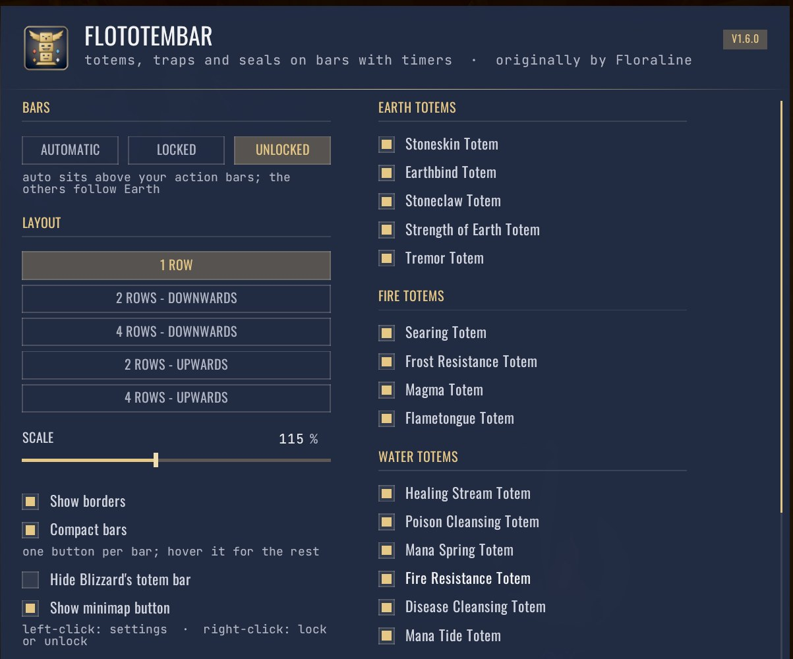

**Totem, trap and seal bars with timers, made for WoW Forever.**

Shamans get a bar per element, hunters a trap bar, paladins a seal bar: clickable buttons with cooldowns, durations and keybinds. Originally by **Floraline** (MPL 2.0), maintained for WoW Forever by **paradosi-Dreamscythe**.

**WoW Forever only** (interface 16001). Version 1.4.0 was the last for Classic Era and TBC Anniversary; it stays downloadable but gets no updates.

## Features

- **Shaman:** four bars, Earth, Fire, Water and Air, with each totem's remaining time. Several layouts: one row, two rows, four rows, reversed.
- **Hunter:** a trap bar (Immolation, Freezing, Frost, Explosive) with cooldowns. It docks beside FloAspectBar Forever when both are installed.
- **Paladin:** a seal bar with every seal, including Forever's Seal of Fury.
- **Compact bars** (optional): one button per bar showing the spell you used last; hover it for the rest, click one to cast it. Works in combat.
- **Keybinds** through the game's Key Bindings menu (traps and seals use the Earth bar's bindings).
- **Your order, your spells.** Drag spells on and off the bars; hide the ones you don't use.
- **Where you want it.** Automatic (above your action bars), locked, or unlocked to drag anywhere.
- **Your look.** Background colour and opacity, borders, scale from 50% to 200%, optional Masque skins.
- **Hide Blizzard's own totem bar** if you'd rather use these (Shaman).
- **Settings panel** in the same navy-and-gold look as the author's other WoW Forever addons: Esc > Options > AddOns > FloTotemBar Forever, or **Options...** in a bar's right-click menu.
- **Minimap button.** Left-click for settings, right-click to lock or unlock, drag to move it. It can be turned off; the addon is also in the addon compartment.

Trap and seal timers always run their full length: WoW Forever doesn't let addons read the combat log, so a bar can't tell when a trap is sprung or a seal ends early. Totem timers follow the real totem.

## Slash commands

| Command | Does |
|---|---|
| `/ftb` | Help, the version and the GitHub link |
| `/ftb options` | Open the settings panel |
| `/ftb minimap` | Show or hide the minimap button |
| `/ftb compact` | Compact bars on or off |
| `/ftb lock` / `/ftb unlock` | Lock the bars, or unlock them to drag |
| `/ftb auto` | Place them automatically above your action bars |
| `/ftb scale <num>` | Set the scale, e.g. `/ftb scale 1.5` |
| `/ftb borders` / `/ftb noborders` | Show or hide borders |
| `/ftb hideblizzard` / `/ftb showblizzard` | Hide or show Blizzard's own totem bar (saved per character) |
| `/ftb reset` | Reset all settings (reloads the UI) |

## Works well with

- **[FloAspectBar Forever](https://github.com/paradosi/FloAspectBar-Classic)**: hunter aspects on one bar; the trap bar docks beside it.
- **Masque**: button skins.

## Help and bug reports

The settings panel shows the installed version, and its **Help and bug reports** button gives you the GitHub address to copy. Source, full documentation and issue tracker: [github.com/paradosi/FloTotemBar-Classic](https://github.com/paradosi/FloTotemBar-Classic)

Licence: Mozilla Public License 2.0. The bundled fonts (Oswald, JetBrains Mono) are under the SIL Open Font License.
